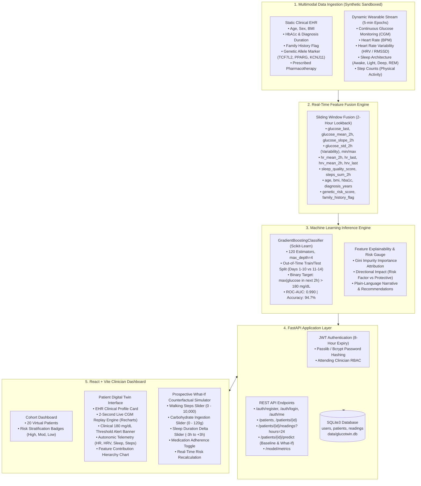

# GlucoTwin Architecture & System Design

**Digital Twin Platform for Type 2 Diabetes (T2D)**  
*Digital Twin Challenge 2026 – Happiest Health*

---

## 1. System Architecture Overview

GlucoTwin fuses static clinical Electronic Health Records (EHR) with high-frequency dynamic wearable time-series to construct an algorithmic virtual patient. The system predicts an adverse acute glycemic event—**a glucose spike exceeding 180 mg/dL within the next 2 hours**—and provides an interactive clinical dashboard featuring real-time stream replay, SHAP-aligned feature attribution, and prospective "What-If" counterfactual simulation.

---

## 2. Component Breakdown

### 2.1 Multimodal Data Ingestion & Simulation
- **Static EHR Data**: Encapsulates immutable or slow-moving clinical variables:
  - Age (42–74)
  - Biological Sex
  - Body Mass Index (BMI: 23.8 to 36.8 kg/m²)
  - Glycated Hemoglobin (HbA1c: 5.9% to 10.2%)
  - Diagnosis duration (0.5 to 16.0 years)
  - Genetic risk variants (e.g. *TCF7L2* rs7903146 TT risk allele, *PPARG* Pro12Ala, *KCNJ11* E23K)
  - Current pharmacotherapy (Metformin, SGLT2 inhibitors, GLP-1 receptor agonists, sulfonylureas).
- **Dynamic Wearable Telemetry**: Synthesizes 14 days of continuous 5-minute readings (4,032 records per patient; 80,640 records total) modeling:
  - Estimated Average Glucose baseline: $\text{eAG} \approx 28.7 \times \text{HbA1c} - 46.7$
  - Diurnal Circadian Rhythm: Nocturnal dip (01:00–04:00) and hepatic dawn phenomenon gluconeogenesis surge (04:30–07:30).
  - Meal excursions: Postprandial excursion curves following breakfast (08:00), lunch (13:00), dinner (19:30), and snacks, scaled to patient insulin resistance.
  - Physical activity clearance: Step bouts stimulate muscular GLUT-4 translocation, clearing glucose over 45 minutes.
  - Autonomic tone: Heart rate and HRV (RMSSD) reflecting physiological stress, sleep architecture, and sympathetic/parasympathetic tone.

### 2.2 Feature Fusion Engine
For any assessment timestamp $T$, the engine looks back 2 hours ($T-2h$ to $T$, corresponding to 24 discrete 5-minute epochs) and extracts 18 fused features:
1. `glucose_last`: Current glucose reading
2. `glucose_mean_2h`: Mean glucose across the 2-hour window
3. `glucose_std_2h`: Glycemic variability (standard deviation)
4. `glucose_min_2h`: Window nadir
5. `glucose_max_2h`: Window peak
6. `glucose_slope_2h`: Rate of rise/fall ($\Delta \text{mg/dL} / \text{hour}$)
7. `hr_mean_2h`: Mean heart rate
8. `hr_last`: Current heart rate
9. `hrv_mean_2h`: Mean autonomic HRV (ms)
10. `hrv_last`: Current HRV
11. `sleep_quality_score`: Restorative sleep metric derived from deep/REM proportions
12. `steps_sum_2h`: Cumulative steps taken in the past 2 hours
13. `age`: Patient age
14. `bmi`: Body Mass Index
15. `hba1c`: Glycated hemoglobin percentage
16. `diagnosis_years`: Duration of Type 2 Diabetes
17. `family_history_flag`: 1 if positive family history, 0 otherwise
18. `genetic_risk_score`: Numeric allele burden derived from clinical genotype.

### 2.3 Machine Learning Pipeline
- **Target Formulation**: Binary adverse event:
  $$Y = 1 \iff \max_{t \in [T, T+2h]} (\text{glucose}_t) > 180\text{ mg/dL}$$
- **Out-of-Time Train/Test Partition**: To eliminate temporal data leakage, samples are partitioned chronologically across all 20 patients:
  - **Training Cohort**: Days 1 through 10 (71.4% of timeline)
  - **Evaluation Cohort**: Days 11 through 14 (28.6% out-of-time test set)
- **Classifier**: `GradientBoostingClassifier` with 120 estimators, learning rate of 0.08, and maximum depth of 4.
- **Evaluation**: Out-of-time ROC-AUC: **0.990**, Accuracy: **94.7%**, Precision: **96.8%**, Recall: **93.2%**.

### 2.4 Prospective "What-If" Counterfactual Simulation
The digital twin allows clinicians to prospectively test non-pharmacological and pharmacological interventions before they happen:
- **Exercise Intervention**: Clinician adjusts extra walking steps (0 to 10,000 steps). The twin simulates muscular glucose disposal, adjusting `steps_sum_2h`, blunting `glucose_slope_2h`, and reducing impending spike probability.
- **Dietary Intervention**: Clinician adjusts upcoming carbohydrate intake (0 to 120 grams). The twin models postprandial glucose flux.
- **Sleep & Recovery**: Adjusts previous night sleep delta (-3h to +3h), modeling autonomic recovery and cortisol resistance.
- **Medication Adherence**: Tests the glycemic impact of missing a prescribed antidiabetic medication dose.

---

## 3. Security, Privacy & Compliance

- **DPDP & HIPAA Compliance**: The system operates exclusively within a synthetic data sandbox. All clinical metrics, names, and readings are generated deterministically via physiological equations. No real patient data is ingested or stored.
- **Authentication**: Stateless JSON Web Tokens (JWT) signed via HMAC-SHA256 with an 8-hour expiry window. Passwords hashed using `bcrypt` (pinned to `bcrypt==4.0.1` to eliminate C-library compatibility anomalies).
- **CORS Protection**: Whitelisted origin boundaries (`localhost:3000`, `localhost:5173`) with strict header filtering.
